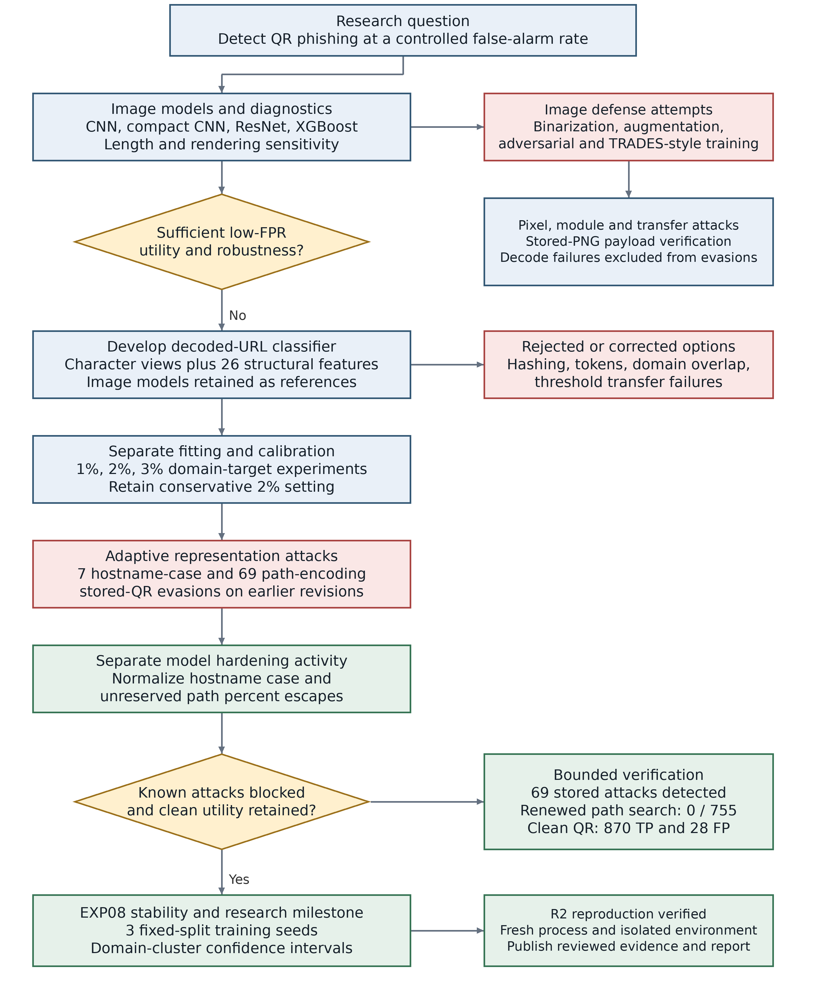

  ⭐ <b>If you find this work useful, consider starring the repository!</b>

# QR phishing detection and representation attacks

This V1 study compares image classifiers with classification of decoded URL text.
The retained model combines character TF-IDF, 26 structural features and logistic
regression. Explicit hostname and unreserved-path normalization removed two tested
representation attacks while preserving the measured clean detection counts.

The study also records the approaches that did not solve the problem: rendering
shortcuts, limited image-model utility at low false-alarm rates, nonuniform
adversarial-training gains and a complete decoder availability failure under
stronger blur.

**The verified frozen R2 package is available as individual files in
[models/quishing_v1](models/quishing_v1/).** It includes the three exported models,
inference code, pinned requirements, hashes and verification fixtures. The
[full lab and independent replay results](evidence/quishing_v1/README.md) and
[original split manifest](data/qr_splits_seed42.csv) are also included.

Technical reproduction passed in my lab environment (Cube-AI), using Python 3.11.15.
A subsequent isolated Python 3.12.14 replay with the same pinned dependencies
matched all 21,723 recorded image results with a maximum score difference of zero.
It also verified 755 URL pairs per model. This replays the V1 cohorts; it does not
provide a new performance estimate on independent data.

## Global overview of the research journey

*Outcomes apply to the stated model revision and evaluated scope. The seven
hostname-case and 69 path-encoding cases are distinct attack families and must
not be summed as unique sources.*

## Results and their scope

These are results on **previously inspected development validation**. Feature,
threshold and defense decisions used this data during development. Earlier
notebook history also contains test-set evaluations.

| Measure | Observed result | Interpretation |
|---|---:|---|
| Phishing detected | 870 / 972, **89.51%** | 102 phishing examples missed |
| Legitimate examples flagged | 28 / 984, **2.85%** | URL-level false-positive rate |
| Clean PNG payload recovery | 1,956 / 1,956 | Evaluated synthetic 69 × 69 convention |
| Recall 95% domain-cluster interval | 85.38–93.05% | Fixed-model evaluation uncertainty |
| FPR 95% domain-cluster interval | 1.76–4.00% | Excludes selection, fit and split uncertainty |
| Stored path attacks before correction | 69 / 755, **9.14%** | Conditional on eligibility and initial detection |
| Those known attacks after correction | 69 / 69 detected | Known-attack regression |
| Renewed path search | 0 / 755 evasions found | 90,088 score queries; tested family only |

Hostname-case changes earlier produced seven stored-QR evasions among 826
eligible sources. That family and the path-encoding family are separate;
their counts must not be added as distinct victims.

The 2% calibration target gives equal total weight to each legitimate calibration
domain. It is a different quantity from the measured 2.85% URL-level validation
FPR. Inference uses the full exported threshold; rounded values printed in tables
are unsuitable for reconstructing it.

## What the four notebooks do

| Notebook | Purpose | What is executed or displayed |
|---|---|---|
| [01 baseline](01_quishing_cnn_baseline.ipynb) | Historical CNN and attack experiments | Training and experimental code |
| [02 research](02_quishing_robust_detection.ipynb) | Full V1 investigation through EXP08 | Includes the 224-cell notebook 01 history, then later research |
| [03 demonstration](03_quishing_technical_demo.ipynb) | Explain five representative cases | Fresh decoding alongside **saved** classifier scores and decisions |
| [04 reproduction](04_quishing_reproduction_qa.ipynb) | Export frozen R2 models and verify independent loading | **Fresh classifier inference**, then installation and verification in an isolated environment |

The five demonstration cases are: a correctly classified legitimate QR, a detected
phishing QR, a stored path-encoding evasion against R1, that same attack detected
by R2, and blur causing abstention. They were selected to explain behavior.
They are not a representative performance sample. Seed 42 is a fixed
presentation convention rather than a selected winning seed.

Notebook 03 does not independently recalculate classifier scores. In particular,
its R2 candidate verdict uses membership in the verified all-69 attack cohort;
it does not invent a candidate-specific R2 score. Notebook 04 subsequently
recalculates predictions and verifies source IDs 31, 5 and 4818.

The publication copies of notebooks 01–03 keep every original source cell in its
original position, with outputs cleared to omit historical QR images and raw
payload displays. Notebook 04 retains its numeric execution evidence and
generalizes the experiment-root display path. Source and publication hashes are
recorded in [notebook provenance](evidence/notebook_provenance.json). The
[research report](docs/RESEARCH_REPORT.md) takes executed measurements over
inconsistent historical Markdown annotations; those discrepancies are documented.

## Reproduction that actually passed

The R2 export binds the original checkpoint functions to importable modules.
It preserves learned parameters and exact thresholds without fitting or calibration.
The checks cover:

1. Source artifact hashes, three checkpoints and captured decoder lineage.
2. Separate-process inference for all 1,956 clean and 69 known-attack PNGs with
   all three seeds, plus 755 retained URL pairs per seed.
3. Eight image transformations on the entire 1,956-image clean cohort with seed 42.
4. A fresh virtual environment without inherited system site-packages, with exact
   recorded inference dependency versions.
5. The same clean and attack cohorts and text pairs in that environment, with a
   fixed 16-image subset per transformation for environment parity.
6. Matching acceptance, payload hashes and decisions, with score tolerances
   rtol 1e-10 and atol 1e-12.

| Transformation | R2 full-cohort result |
|---|---|
| Rotations 90°, 180° and 270° | All payloads recovered; 870 detections, 28 false alarms |
| JPEG quality 90 and 60 | Same result |
| Gaussian blur σ = 0.5 | Same result |
| Contrast factor 0.65 | Same result |
| Gaussian blur σ = 1.0 | **0 accepted decodes; 1,956 abstentions** |

The fresh transformed subset is a parity check. Its higher recall is not a new
performance estimate to replace the full cohort.

Seeds 42, 142 and 242 share the same exported learned-state fingerprint and the
same results. They do not measure different learned states or alternative data
splits. The confidence intervals resample 1,260 complete domain groups, with
2,000 draws, while keeping fitted models and thresholds fixed.

See [reproduction instructions](docs/REPRODUCIBILITY.md) for the exact prerequisites
and the published frozen package.

## Attack definitions and limits

Pixel and module attacks require the exact original decoded payload after
storage. A deterministic URL classifier receives an unchanged input under that
constraint. Zero URL-model evasions there do not demonstrate URL-content robustness.

Hostname and path attacks change the payload text and regenerate a QR.
The path attack percent-encodes ASCII unreserved characters only. Its equivalence
claim assumes that scheme-less strings are interpreted as hostname-plus-path
web addresses. No live destination was contacted to verify application or server
behavior. R2 performs one normalization pass, preserves queries, fragments and
reserved escapes, and keeps unsupported input formats unchanged.

The decoder accepts one distinct nonempty text across OpenCV and ZXing results.
Either decoder may supply it; conflicting texts cause abstention. An abstention
is neither a legitimate verdict nor phishing detection. The complete failure
under blur σ = 1.0 is an availability limit, even though the software correctly
reports abstention.

The evidence does not establish camera robustness, arbitrary-URL robustness,
independent new-data generalization, a significant final fusion advantage, or
production readiness. URLBERT was considered but not evaluated.

## Reading and using the material

- [English report](docs/RESEARCH_REPORT.md) and [editable Word report](docs/Quishing_V1_Research_Report_EN_v4.docx).
- [Editable diagrams](docs/Quishing_V1_Editable_Diagrams_v3.drawio).
- [Frozen models and verification inputs](models/README.md).
- [Reproduction instructions](docs/REPRODUCIBILITY.md).
- [Full artifact verification](evidence/quishing_v1/README.md).
- [Method, dataset and assistance attribution](docs/ATTRIBUTION.md).
- [Recorded QA summaries](evidence/README.md).
- [Release status](docs/PUBLICATION_STATUS.md).

Run the notebooks locally in the experiment directory. The original research
requires the source dataset and exact split manifest. The short inference route
uses the included frozen exported package. The source dataset remains available
from its authors for research training; it is not required to replay the included
frozen-inference verification fixtures.

## Attribution and assistance

The dataset is by **Fouad Trad and Ali Chehab** and is distributed by its authors
under **CC BY 4.0**. Dataset selection and transformed or regenerated QR fixtures
are adaptations; attribution and source links are in
[ATTRIBUTION.md](docs/ATTRIBUTION.md). This lab was inspired by an idea from Hamza Kondah.

Code and explanations were developed with substantial assistance from ChatGPT;
candidate ideas were also discussed using Claude and Kimi. Natacha executed the
experiments in the lab environment and supplied the executed notebooks for review. The V1
contribution is the documented comparison, failure analysis, attack–correction
cycles and reproduction evidence, with established methods attributed.
