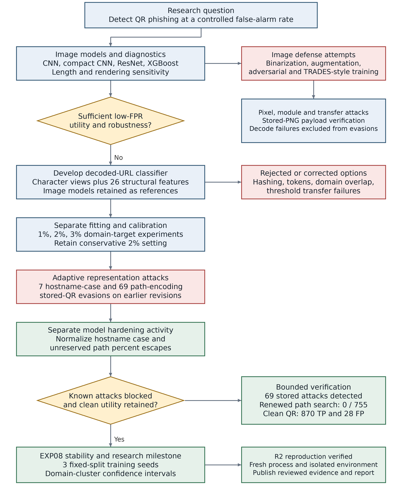
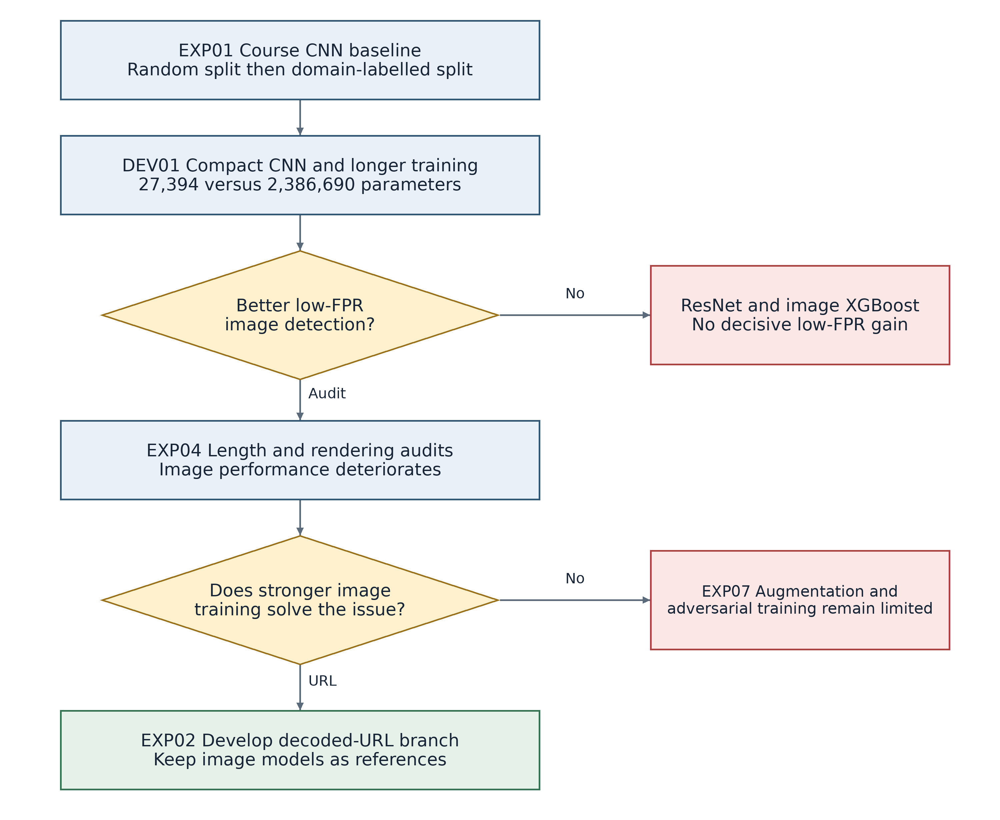
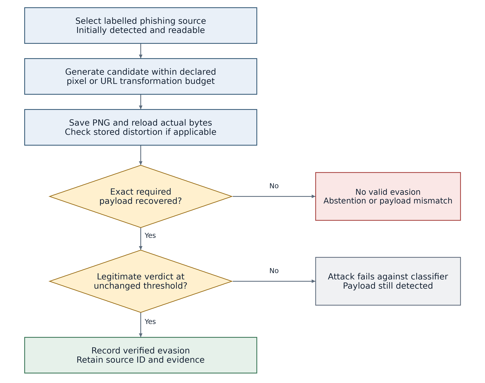
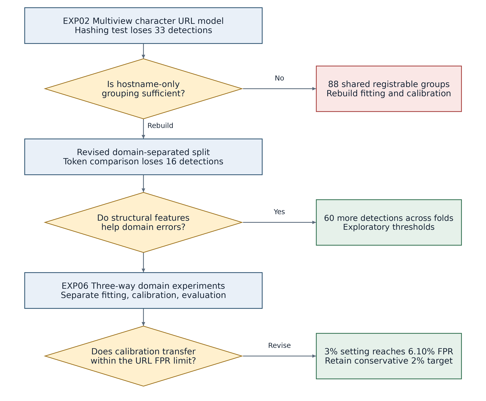
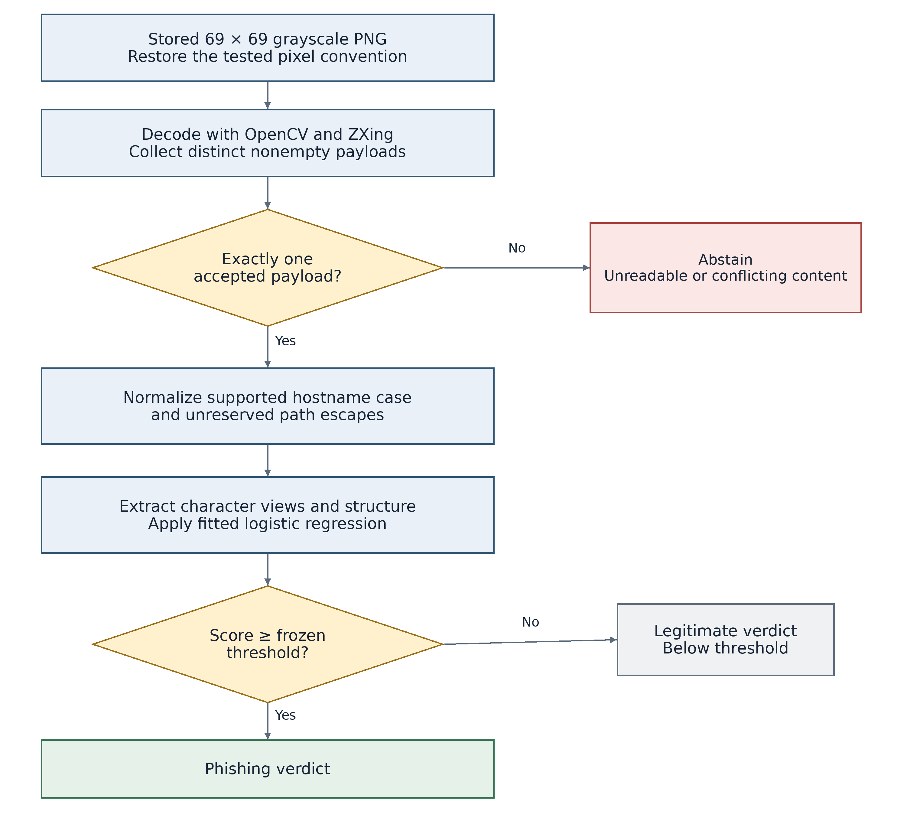
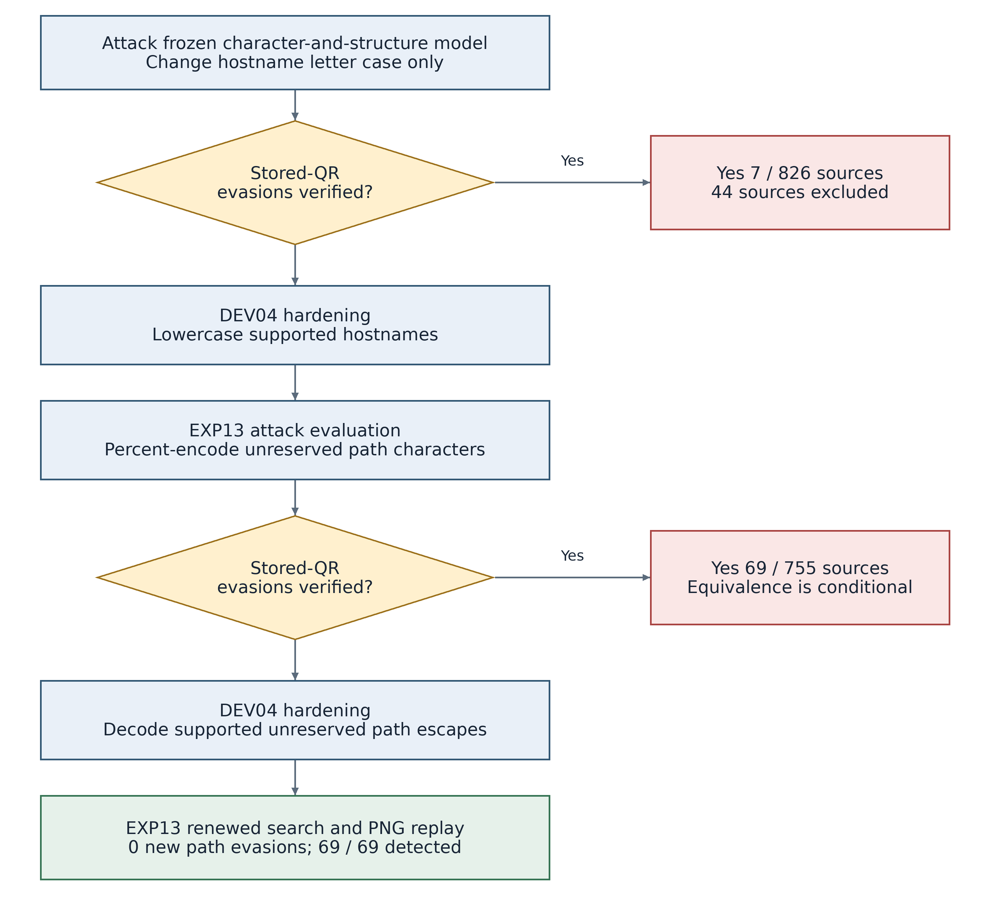

# Quishing Detection Research Report

Experiment 14   V1 reproduction verified   22 November 2026

Author  Natacha
Evidence snapshot  Research through EXP08, executed demonstration and reproduction QA

### Research decision

We retain a decoded-URL classifier with hostname and path normalization for the bounded V1 research findings. It combines multiview character TF-IDF with structural URL features and logistic regression. The main result is a stronger evaluated representation and a documented attack–correction cycle, rather than a claim of general phishing protection.

| Final development measure | Observed result |
| --- | --- |
| Phishing detection | 870 / 972  \|  89.51% recall |
| False alarms | 28 / 984  \|  2.85% URL FPR |
| Clean PNG recovery | 1,956 / 1,956 exact payloads |
| Missed phishing | 102 |
| Known stored path attacks after correction | 69 / 69 detected |
| Renewed path search | 0 evasions on 755 sources |
| Training repetitions | Seeds 42, 142 and 242 |

### What the experiments established

Image-only models were sensitive to rendering and supplied limited recall at low false-positive rates. URL features performed better on the inspected development cohort. That improvement did not imply robustness: hostname-case changes and path percent encoding produced stored-QR evasions. Narrow, component-preserving normalization removed those tested differences while preserving aggregate clean detection and false-alarm counts.

All final metrics use validation data inspected repeatedly during development. The final study did not run a new test evaluation, but the notebook history already includes test-set use. The report therefore presents exploratory development evidence, not an untouched-test estimate or a production-readiness assessment.

Evidence: Research notebook cells 359–370 and executed reproduction notebook 04. Earlier executed outputs take precedence over stale narrative annotations. Cell positions in this report are one-based notebook positions, not execution counters.

## Global overview of the research journey

Read top to bottom. Blue boxes identify experiments, amber diamonds decisions, red boxes unsuccessful attempts or exposed weaknesses, and green boxes retained corrections or findings. Attack evaluation and model hardening are separate activities.

Global overview. Outcomes refer to their stated model revision and evaluated scope. The 7 hostname and 69 path cases are distinct attack families and must not be summed as unique sources.

## 1 Research question and evaluation scope

The study asks whether a QR phishing detector can retain useful detection at a controlled false-alarm rate while resisting explicitly defined attacks. It compares image classification with classification of the URL recovered from the QR, then tests how preprocessing and representation choices alter both utility and attack outcomes.

| Data stage | URLs | Phishing | Legitimate |
| --- | --- | --- | --- |
| Original training split | 5,872 | 2,917 | 2,955 |
| Final fitting subset | 4,697 | 2,334 | 2,363 |
| Final calibration subset | 1,175 | 583 | 592 |
| Original validation | 1,956 | 972 | 984 |
| Historical domain-labelled test | 1,957 | 973 | 984 |

The raw image array contains 9,987 images of 69 × 69 pixels. The split manifest covers 9,785 records. This report preserves that distinction; it does not infer the reason for the 202 records outside the manifest. The random-split baseline used 5,871 training and 1,957 validation records, so its cohorts must not be silently substituted for the later split.

### Three distinct attack settings

Pixel attacks change image intensities under an L-infinity budget and seek a legitimate verdict while retaining the exact original payload after storage. Module attacks flip selected data modules under a module/query budget. URL-representation attacks change the payload text, regenerate the QR and check a defined address-equivalence condition. The last setting has no pixel-distortion budget.

### Outcome definitions

Recall uses all phishing sources in the stated cohort. URL false-positive rate is the fraction of legitimate sources flagged. Coverage is the fraction with an accepted decoded payload. A decode failure or disagreement is an abstention, not a legitimate verdict and not a successful phishing detection. A score is not treated as a calibrated probability.

The final fitting and calibration subsets share zero registrable-domain groups. Earlier split labels and hostname-disjoint checks do not, by themselves, prove registrable-domain separation everywhere in the original experiment.

Evidence: Cells 3, 74, 228, 293–295 and 365. Grouping uses an offline public-suffix snapshot including private rules.

## 2 Experimental journey through image models

The timeline below follows notebook order. It records experiments and decisions rather than assigning calendar dates that are absent from the evidence. Rectangles are experiments or findings; diamonds are decisions. Red branches preserve unsuccessful or insufficient attempts.

Figure 1. Image-model development and the evidence supporting a decoded-URL branch.

The smaller model reduced parameter count by 98.85%, but efficiency did not establish detection superiority. Transfer learning and a longer training budget improved some losses without resolving low-FPR utility. These outcomes motivated a representation change rather than endless image-model tuning.

Evidence: Cells 79, 86–110, 120, 127–129 and 187–250.

## 3 Detector comparisons and dataset shortcuts

### Comparable early low-FPR measurements

The following models used the same 1,956 domain-validation examples, with thresholds selected on that validation cohort. Each row flags 49 legitimate URLs (4.98%). These are development operating-point comparisons, not independent test results.

| Detector | Detected / 972 | Recall |
| --- | --- | --- |
| Reference CNN | 514 | 52.88% |
| Compact CNN with extended training | 542 | 55.76% |
| XGBoost on raw pixels | 529 | 54.42% |
| XGBoost on 150 descriptors | 518 | 53.29% |
| URL lexical XGBoost | 746 | 76.75% |
| URL character TF-IDF and LR | 844 | 86.83% |
| Later multiview URL model | 870 | 89.51% |

### Evidence of a length-related shortcut

A URL-length-only diagnostic reached AP 0.8438 on the full validation cohort. Matching phishing and legitimate examples by exact payload length retained 429 pairs, or 858 URLs. On this selected subset, compact-CNN AP fell from 0.8817 to 0.6326, while character-URL AP remained 0.9627. A QR-structure-only diagnostic reached AUC 0.5072 after length matching.

This is evidence of a confound, not a causal explanation of every learned feature. The subset is selected and uses frozen original thresholds, so its false-positive rate is not constrained to 5%. It cannot replace full-cohort performance.

### Transfer learning and fusion

ResNet-18 had 11,177,538 parameters. Lower learning rates and frozen BatchNorm statistics reduced its best validation loss to 0.4698, but did not establish superiority over the reference. An earlier orientation-protected fusion added seven detections at the same 49 false alarms. Its paired recall-difference interval crossed zero (−0.11 to +1.69 percentage points), so the report makes no significant fusion-superiority claim.

Evidence: Cells 100, 110, 120, 127–129, 237, 249, 253 and 269. Threshold-selection procedures differ from the later final candidate.

For historical context, the executed random-split CNN test output reports 80.12% accuracy and 22.13% FPR. The domain-labelled run reports 78.69% accuracy and 24.49% FPR. These use F1-selected thresholds and different test samples; neither is a paired low-FPR comparison with the final URL candidate.

## 4 Attack verification beyond prediction flips

The attack benchmark progressively replaced floating-point flips with storage-aware verification. PGD follows the robust-optimization attack setting [1]; the notebook also implements threshold-aware DeepFool-style and bounded query checks. The rules below distinguish a classifier failure from an unreadable or changed QR.

Figure 2. Storage and payload verification gates. The required payload is the original text for pixel attacks and the exact transformed candidate for URL attacks.

The final decoder accepts one distinct nonempty text across OpenCV and ZXing results. One decoder may succeed while the other is silent. Conflicting recovered texts cause abstention. Earlier attack tables sometimes used “either decoder”; their acceptance rule must remain labelled as historical.

Evidence: Cells 39–50, 155–163, 175–177, 200–211 and 343.

## 5 Defense attempts and their limits

| Attempt | Observed outcome | Decision |
| --- | --- | --- |
| Binarization | Restores binary sources for small budgets | Retain bounded explanation |
| Rotation augmentation | Suppresses rotation false alarms substantially | No general robustness claim |
| Warm-start adversarial training | Some gains at ε = 0.05, losses at ε = 0.025 | No uniform benefit |
| Regularization and corruption training | Low-FPR recall remains near 52–56% | Keep as ablations |
| TRADES-style training | Seed 242 selects epoch zero | Do not credit unperformed update |
| URLBERT | Author weights/configuration unavailable locally | Not evaluated |

### Why a simple defense appeared stronger than it was

For binary source pixels and an attack radius below 0.5, thresholding at 0.5 restores the original binary values. Zero verified evasions in that restricted setting follow from the representation constraint; they do not certify resilience to module changes, grayscale inputs or URL-content changes. The later quantized-forward attack uses an approximate backward pass and verifies the real defense, consistent with the need to assess gradient masking [2].

### Adversarial training did not dominate the clean CNN

On 495 sources detected by both clean and warm-start CNNs, equalized attack checks at ε = 0.05 produced 371 valid evasions against the clean CNN and 358 against the warm-start model. At ε = 0.025, the same-source comparison gave 166 versus 204, so the defended model was worse. At ε = 0.10 and 0.20, both reached 495/495 valid evasions under the tested attack. Pixel adversarial training also left catastrophic rotation false alarms.

In the later three-seed TRADES-style study [3], mean recall at the 5% development operating point was 55.69%. Seed 242 retained epoch zero, which was the unchanged compact warm start. That run cannot be described as an improvement caused by adversarial updates.

Fixed re-encoding introduced capacity abstentions: 5,716/5,872 training payloads and 1,954/1,956 validation payloads fit the fixed QR encoder. The excluded inputs remain part of coverage accounting.

Evidence: Cells 189–221, 234, 240–250 and 259–266. The notebook diagnostic shows learning signal in an early run labelled “failure”; this report does not call it numerical collapse.

## 6 Module and transfer attack findings

The later module search explicitly moved beyond small intensity changes. It allowed changes to 1, 4 or 8 data modules, with up to 200 complete-pipeline search queries per source. Every retained candidate underwent storage, decoding and exact-original-payload verification. The rows below report model-conditional cohorts, not a common denominator.

| Historical detector | Eligible | 1 module | 4 modules | 8 modules |
| --- | --- | --- | --- | --- |
| D0 Compact CNN | 542 | 30 | 52 | 79 |
| D2 Canonicalized CNN | 542 | 30 | 52 | 79 |
| D4 Corruption trained | 543 | 9 | 40 | 53 |
| D5 TRADES seed 42 | 544 | 35 | 66 | 92 |
| Multiview URL model | 870 | 0 | 0 | 0 |
| Orientation fusion | 877 | 3 | 5 | 5 |

The common intersection contained 469 initially detected sources. At eight modules, the shared-cohort valid-evasion rates were 6.61% for D0, 4.90% for D4 and 8.74% for D5. The larger model-conditional counts must not be read as a paired ranking. In particular, TRADES did not improve every attack setting.

### What zero URL evasions means in this setting

When the exact decoded input text is unchanged, a deterministic URL-only classifier receives the same input and returns the same score. Its zero module-attack evasions therefore reflect this restricted threat model. They do not establish resistance to changes in the URL text. The later hostname-case and path-encoding experiments deliberately test that missing dimension.

### Transfer and bounded black-box baselines

Earlier transfer experiments used attacks optimized against a source CNN without receiver-model gradients. Pair-specific initial-detection cohorts varied, and the notebook reports them explicitly. The URL branch had zero verified exact-payload transfer evasions, while image and fusion outcomes varied.

An earlier bounded black-box storage audit against raw-pixel XGBoost verified 227/529 evasions (42.91%). It reported 72,780 search queries plus 529 post-search verification score queries. This is a distinct detector and attack procedure; its rate must not be pooled with the later module search or the URL-content attacks.

These are historical detector revisions. The report does not reassign their module, transfer or black-box measurements to the final hostname-and-path model.

Evidence: Cells 165–171 and 265–266. Model-conditional and shared-source denominators are distinct. Module-query budget and pixel L-infinity budget are different constraints.

## 7 Experimental journey through URL calibration

Figure 3. URL development and calibration decisions. Each correction responds to a measured limitation.

The five-fold character-versus-token comparison used thresholds selected inside each evaluated fold. Those figures are exploratory operating-point diagnostics. Later three-way experiments separate calibration labels from evaluation labels and provide the more relevant threshold-transfer evidence.

Evidence: Cells 280–319. Hashing and tokens alter feature weighting as well as coverage; their results do not isolate vocabulary coverage as a sole cause.

## 8 Structural features and calibration tradeoffs

### An error analysis with a concrete follow-up

In one development fold, pastehtml[.]com accounted for 92 of 134 character-model misses. Structural features raised detections within its 98 phishing examples from 6 to 41. Across five folds, characters plus structure detected 2,716/2,917 phishing URLs versus 2,656 for the character reference. Both had 145 false alarms, but thresholds used evaluation-fold labels; these figures do not demonstrate deployable threshold transfer.

### Three-way development calibration

The table isolates the character-and-structure model in later domain-separated fitting, calibration and evaluation experiments. It predates the final hostname-and-path normalization. The target is an equal-domain-weighted calibration false-alarm rate, not a promised URL-level evaluation rate.

| Domain target | Pooled recall | URL FPR | Worst fold FPR | Folds ≤ 5% |
| --- | --- | --- | --- | --- |
| 1% | 86.05% | 1.42% | 2.37% | 5 / 5 |
| 2% | 88.52% | 2.27% | 3.38% | 5 / 5 |
| 3% | 90.50% | 3.15% | 4.91% | 5 / 5 |
| 5% | 94.03% | 5.28% | 8.97% | 2 / 5 |

### A stricter protocol still revealed transfer failures

Refitting on all training data after out-of-fold threshold selection produced 52/984 false alarms for the structural candidate (5.28%). Keeping fitting and calibration separate avoided that refit mismatch, but URL-weighted 5% calibration still transferred poorly: 145/984 validation false alarms (14.74%). One legitimate calibration domain contributed 359 of 592 URLs, motivating equal total weight per legitimate domain.

The initially retained 3% domain-calibrated checkpoint detected 889/972 phishing URLs but flagged 60/984 legitimate URLs (6.10%). The existing conservative 2% setting detected 870 and flagged 28 (2.85%). Choosing that setting after inspecting validation is a development decision. The conservative margin and bootstrap interval do not remove selection bias.

Evidence: Cells 301–323. The 88-group overlap concerns the initial fitting/selection development split; the rebuilt split has zero shared registrable groups.

## 9 Retained inference pipeline

Figure 4. Final hostname-and-path candidate. Expected payloads and dataset labels are audit-only inputs, never inference inputs.

Normalization precedes both feature branches. The full URL, hostname and path views use character n-grams of length 3–5 with case preserved after explicit normalization. The numerical branch contains 26 structural features, fitted scaling and no inference-time learning. Logistic regression uses C = 10, liblinear and a maximum of 2,000 iterations.

Evidence: Cells 245, 306, 343, 358–359 and 363. Approximately 0.533642 is displayed; inference uses the full stored threshold.

## 10 Experimental journey through adaptive attacks

Figure 5. Attacking and hardening are distinct activities. Historical checkpoints remain preserved at each stage.

The first explicit HTTP(S) path-attack protocol found zero eligible sources because all 870 detected phishing payloads lacked an explicit scheme. The revised experiment documented a hostname-plus-path interpretation, rather than silently adding a scheme to classifier inputs.

Evidence: Cells 329–339 and 347–363. Repeated inspection and correction are development, not independent confirmation.

## 11 Verified URL representation evasions

| Attack stage | Eligible | Verified or found | Query accounting |
| --- | --- | --- | --- |
| Hostname case before correction | 826 | 7 stored evasions | 27,248 score calls |
| Hostname case after hostname correction | 826 | 0 text evasions | 27,247 score calls |
| Path encoding before path correction | 755 | 69 stored evasions | 90,088 score calls |
| Path encoding after path correction | 755 | 0 text evasions | 90,088 score calls |

Hostname search allowed at most 32 variants plus an original score. The renewed hostname search scored 26,421 distinct variants. Path search allowed at most 128 total score queries per source, including the original. Both path searches scored 89,333 variants plus 755 originals. A new seed changes the tested search trajectory, so equal total budgets do not imply identical variants.

### What the path attack changes

For example, /login can become /%6Cogin because %6C represents the ASCII letter l. Only ASCII letters, digits and -._~ are eligible. The raw hostname, port, separators, query and fragment remain unchanged. Existing valid percent escapes are preserved. Decoding the newly encoded unreserved characters must recover the original path exactly [4].

All 69 retained candidates fit the fixed QR encoder, were saved as PNGs and yielded the exact candidate text after reload. The unchanged classifier then returned legitimate. The 9.14% rate uses the 755 eligible, initially detected sources. It must not use all 972 phishing URLs as its conditional attack-success denominator. Among the 870 detected sources, 71 lacked eligible path characters, 39 had unsupported hostnames and five required separate whitespace handling.

### Why destination equivalence remains conditional

QR decoding and classifier bypass are directly verified. Equivalent handling by a particular browser or server is not: the payloads are scheme-less, and no destination was contacted. The experiment assumes web-address interpretation and unreserved-character equivalence. It does not demonstrate a live phishing campaign or pixel-only evasion at identical payload.

These were not only marginal threshold crossings. Across the 69 verified candidates, mean score fell from 0.8419 to 0.2940. Source 4818 changed from 0.996262 to 0.115849. Those scores describe model output, not phishing probabilities.

Evidence: Cells 329–331, 339, 350–357 and 362. Query totals include original scoring; only one retained candidate per successful source underwent stored-QR verification.

## 12 Final candidate stability and uncertainty

| Training seed | Threshold shown | Detected / 972 | False alarms / 984 |
| --- | --- | --- | --- |
| 42 | 0.533642 | 870 | 28 |
| 142 | 0.533642 | 870 | 28 |
| 242 | 0.533642 | 870 | 28 |

Each model was fitted on the same 4,697 fitting URLs. Each threshold was independently selected on the same separate 1,175 calibration URLs at the fixed 2% domain-average target. No refitting followed calibration, and no winning seed was chosen. Identical displayed thresholds do not justify rounding at inference.

| Metric | Point estimate | 95% domain-cluster interval |
| --- | --- | --- |
| Phishing recall | 89.51% | 85.38–93.05% |
| URL false-positive rate | 2.85% | 1.76–4.00% |

### How the intervals were computed

The validation cohort contains 1,260 registrable-domain groups. A percentile bootstrap sampled whole groups with replacement 2,000 times, retaining all URLs within every selected group. Bootstrap seed 542 and identical domain draws were used across the three models. The ratios retain URL-level numerators and denominators even though resampling occurs at domain level.

The intervals describe uncertainty in evaluation of the fitted models at their fixed calibrated thresholds. They do not include new fits, recalibration, different train/calibration splits or development-selection bias. The upper false-positive bound below 5% is reassuring for this inspected cohort, not a guarantee on future sources.

### Attack regression and complete clean replay

Every seed detected all 69 previously successful stored path-attack PNGs. For 755 retained source–variant pairs, all original sources remained detected and pairwise score differences were zero. These are regression checks on known attacks, not three independent fresh adaptive searches. Separate clean PNG replay of the reference final candidate recovered 1,956 exact payloads with no abstention and reproduced 870 detections and 28 false alarms.

Evidence: Research cells 363 and 365–370; reproduction cell 10. The three exports have the same learned-state fingerprint and aggregate results. The repetitions therefore do not measure variability between distinct learned states or alternative splits.

## 13 Reproducibility lineage and measured cost

### Three model revisions must remain distinct

| Revision | Evidence available | Delivery status |
| --- | --- | --- |
| R0 Characters plus structure | 3% and 2% calibration checkpoints; attacks exposed hostname case | Historical research checkpoint |
| R1 Hostname normalized | 1,963 URL and 2,091 QR fresh-process parity inputs | Exported in same environment |
| R2 Hostname and path normalized | Final clean and transformed replay, known-attack checks and three frozen exports | Fresh process and isolated same-host environment verified |

R1 full-pipeline parity covered 1,956 clean images, seven stored hostname attacks and 128 transformed examples (16 for each of eight transformations). Parity included decoded text, acceptance, scores and decisions. It demonstrates independent-process loading within the installed environment, not installation from scratch. It must not be attributed to R2.

### Final R2 reproduction in my lab environment

In my lab environment (Cube-AI), notebook 04 exported importable modules and three frozen R2 models with unchanged learned states and thresholds. Separate-process inference recomputed all 1,956 clean and 69 known-attack PNGs and 755 URL pairs per seed. Seed 42 replayed eight transformations over the full clean cohort. A fresh virtual environment installed exact versions and repeated the complete clean and attack cohorts, URL pairs and 16 fixed images per transformation.

Scores matched within relative tolerance 1e-10 and absolute tolerance 1e-12; payload hashes, acceptance and decisions matched exactly. This verifies isolated installation on the same host and Python major/minor version. It does not repeat fitting, independent test evaluation or adaptive attack discovery. Evidence: reproduction cells 15, 20 and 23.

### Cost observations from the notebook

| Measured operation | Recorded time | Interpretation |
| --- | --- | --- |
| Initial compact CNN training | 9.71 s | 15 epochs, earlier baseline |
| Frozen-BN ResNet training | 102.99 s | Different architecture and budget |
| Later TRADES runs | 108.42–108.51 s | Per seed, warm-start study |
| Hostname-case search | 10.19 s | 826 sources before correction |
| Path-encoding search | 296.89 s | 755 sources before correction |
| Final URL fits and calibration | 3.3–5.2 s | Per seed, fixed split |

The recorded environment uses an NVIDIA RTX 2070, PyTorch 2.5.1+cu121 and Python 3.11. Measurements cover different workloads and must not be ranked as a standardized latency benchmark. Decoder caching can reduce repeated timings. No cold-start service throughput, camera latency or peak-memory benchmark is established here.

Evidence: Research cells 2, 86, 98, 242, 329, 341, 345, 352, 366 and 370, plus executed reproduction cells 8–25. The QA notebook does not display total elapsed time; no measured reproduction duration is asserted here.

## 14 Failures and methodological corrections

### Data reuse and threshold selection

Validation guided feature design, calibration procedures, model choice and attack corrections. Choosing the conservative setting after observing a 3% setting fail the URL false-alarm limit is sensible development, but it introduces selection bias. Final bootstrap intervals do not correct that bias. Earlier random and domain-labelled test evaluations also prevent describing the project’s test data globally as untouched.

### Grouping and split uncertainty

An initial hostname-grouped development partition shared 88 registrable domains across fitting and selection. Rebuilding the partition removed that overlap. The final three training seeds use one fixed partition; they do not repeat the earlier five-fold calibration experiment with the final normalization. Domain composition remains a material source of uncertainty.

### Availability failures

The R2 reproduction run repeated the complete transformation suite on all 1,956 clean images with seed 42. Rotations, JPEG 90/60, blur sigma 0.5 and contrast 0.65 preserved 870 phishing detections and 28 false alarms. Blur sigma 1.0 caused 1,956 abstentions, including all 972 phishing sources. Zero false alarms under zero coverage do not demonstrate useful detection. The isolated-environment check repeated all clean and known-attack inputs plus 16 images per transformed condition.

### Restricted attack families

No observed path evasion after normalization establishes invariance for the tested unreserved-encoding family, not for arbitrary URLs. Unsupported formats, query transformations, parser differentials and alternative path semantics remain outside the demonstrated result. Pixel random-noise checks used one candidate per source and budget; they are not adaptive attack evidence.

### Historical narrative inconsistencies

The baseline output reports threshold 0.3694 and 80.12% test accuracy, while retained Markdown describes threshold 0.5343 and 80.79%. The first training output reports best loss 0.4150, while an adjacent comment says 0.4226. This report uses executed numeric output and preserves those discrepancies as an audit finding. It does not silently average incompatible runs.

### Interpretation of unsuccessful experiments

A failed or unhelpful attempt remains evidence about the tested configuration. It does not establish that all image models, all adversarial training or all pretrained URL encoders fail. URLBERT was not evaluated. Early prose describing an adversarial run as a failure does not justify calling its nonconstant, informative predictions numerical collapse.

Evidence: Cells 9–28, 194, 237, 247, 293–295, 327, 333, 337, 350 and 368.

## 15 V1 findings and publication

### Supported findings

The evaluated URL branch provides substantially better development utility than the tested image-only baselines at the earlier shared low-FPR operating point. Structural features help some opaque-hosting failures. Calibration design and domain concentration matter as much as ranking quality: several apparently good settings failed the downstream URL false-alarm limit.

Representation-sensitive URL models remain attackable even when pixel perturbations preserve the exact decoded payload and therefore cannot affect a deterministic URL score. Stored hostname-case and path-encoding attacks made that distinction concrete. Explicit normalization before all feature extraction removed the tested representation changes and retained the final aggregate clean counts.

The final fits produced identical aggregate results and, in the reproduction export, identical learned-state fingerprints on one fixed split. The intervals quantify clustered validation sampling uncertainty. They do not establish split stability, independent generalization or robustness outside the defined transformations.

### Task boundaries after reproduction

| Task | Result at this snapshot |
| --- | --- |
| EXP07 Defense comparison | Research ablations completed with limitations |
| DEV04 Model hardening | Hostname and unreserved-path normalization implemented |
| EXP13 Adaptive evaluation | Hostname/path families evaluated within stated scope |
| EXP08 Final repetitions | Three fixed-split fits, attack regressions and intervals |
| JAL02 Research review | Retain R2 approach for bounded V1 findings |
| DOC01 English report and figures | Report updated with reproduction, attribution and final R2 transformation results |
| DEM01 Demonstration | Five-case saved-evidence demonstration executed; all recorded checks passed |
| QA01 Reproduction | R2 standalone export, fresh-process parity and isolated-environment checks passed |

The executed demonstration and technical reproduction checks are complete. Publication requires the reviewed report, source code and exact reproducible artifacts to be distributed together or made available through documented access. V2 external-data work and the later application remain separate phases. Successful reproduction does not establish deployment acceptance.

Evidence: Research notebook through cell 370, demonstration notebook 03 and reproduction notebook 04 through cell 25. Technical reproduction and public artifact availability are recorded separately.

## Appendix A Evidence index and source policy

Cell positions below are one-based positions in the supplied notebook, independent of Jupyter execution numbers. Each range includes the executed experiment and its local interpretation. Code, stored outputs and model lineage take precedence over stale explanatory text.

| Evidence | Notebook cells | Main use |
| --- | --- | --- |
| Random and domain-labelled baselines | 2–28 and 74–79 | Historical reference and test exposure |
| Image models and XGBoost | 86–110 | Capacity, loss and operating-point comparisons |
| URL baselines and low-FPR audit | 112–129 | Representation and shortcut evidence |
| Pixel attacks and early defenses | 151–221 | Storage validity and limited defense gains |
| Later image ablations and fusion | 228–269 | Three-seed study and paired uncertainty |
| Hashing, grouping and tokens | 280–303 | Rejected options and domain-overlap correction |
| Structure and calibration | 306–323 | Feature gains and threshold-transfer failures |
| Hostname attacks and correction | 329–339 | Seven stored evasions and corrected search |
| R1 export verification | 341–345 | Fresh-process parity for the earlier revision |
| Path attacks and correction | 347–364 | 69 stored evasions, renewed search and clean replay |
| Final repeated training | 365–370 | Seeds, regressions, confidence intervals, checkpoints |

### Source snapshot

Primary experiment source: 02_quishing_robust_detection(3).ipynb, containing 372 cells. Its bytes match the earlier report snapshot. Reproduction evidence comes from 04_quishing_reproduction_qa(1).ipynb. No model training was performed to prepare this report update.

Notebook SHA-256
fbea4171a2895e05a6b5c565844f80f8c5a61bf3eaa672ab8e57f080c117452a

The report records the successful export from the lab environment, separate-process inference and isolated-environment installation shown in the executed QA notebook. Rerunning those checks requires the exact frozen package, its verification fixtures and matching dependency versions. The publication reproducibility guide records their distribution status.

## Appendix B Method references and diagram sources

The following primary sources identify the established methods and URI rules used to interpret this experiment. They do not validate the study’s own measurements or convert empirical negative results into formal robustness guarantees.

[1] Madry et al. Towards Deep Learning Models Resistant to Adversarial Attacks. ICLR 2018.

https://arxiv.org/abs/1706.06083

PGD and robust-optimization attack framing.

[2] Athalye, Carlini and Wagner. Obfuscated Gradients Give a False Sense of Security. ICML 2018.

https://proceedings.mlr.press/v80/athalye18a.html

Why nondifferentiable preprocessing needs attack-aware checks.

[3] Zhang et al. Theoretically Principled Trade-off between Robustness and Accuracy. ICML 2019.

https://proceedings.mlr.press/v97/zhang19p.html

TRADES method attribution. The notebook implementation is a study-specific variant.

[4] Berners-Lee, Fielding and Masinter. RFC 3986 Uniform Resource Identifier Generic Syntax. January 2005.

https://www.rfc-editor.org/rfc/rfc3986.html

Sections 2.3 and 6.2.2 for unreserved characters and syntax-based normalization.

### About the diagrams

The report includes visible images for the global overview and Figures 1–5. Edit the corresponding native objects in the companion draw.io file, then export an updated image to replace the figure in Word. All texts, shape types, fills, outlines and connectors remain editable in that source.

Quishing_V1_Editable_Diagrams_v3.drawio contains the updated GLOBAL overview followed by five detailed diagrams. Open it in diagrams.net to edit any object. Numerical tables and report text remain directly editable in Word.

Diagram reading convention: blue rectangles describe a tested process; amber diamonds pose a decision; red boxes retain failures or weaknesses; green boxes identify a retained correction or outcome. Meaning is also written in the labels, so the diagrams do not depend on color alone.

## Appendix C Attribution

The original dataset is by Fouad Trad and Ali Chehab, Detecting Quishing Attacks with Machine Learning Techniques Through QR Code Analysis (2025), https://arxiv.org/abs/2505.03451. Their dataset repository is https://github.com/fouadtrad/Detecting-Quishing-Attacks-with-Machine-Learning-Techniques-Through-QR-Code-Analysis and carries CC BY 4.0, https://creativecommons.org/licenses/by/4.0/. Our work selects dataset records, generates transformed QR fixtures, compares models and adds attack, normalization, calibration and reproduction experiments. It does not originate that dataset.

This lab was inspired by an idea from Hamza Kondah.

Executed QA source SHA-256
fb7a7cbdad35d0ddd94270ce199b2fe88dfe733aff411f0a21a87ef9f90a494d
